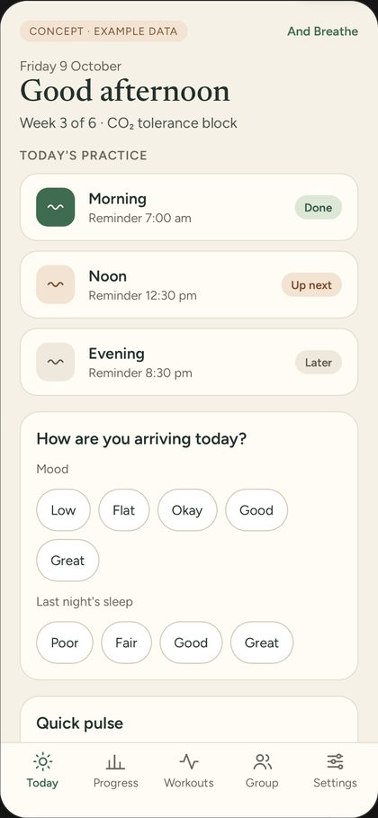
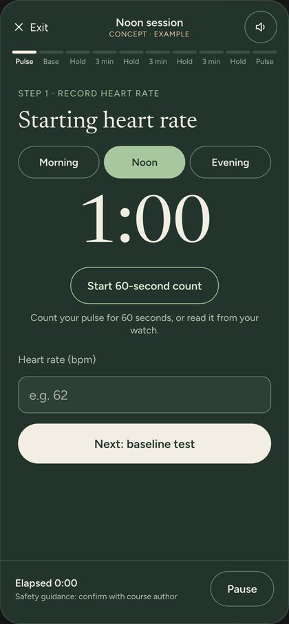
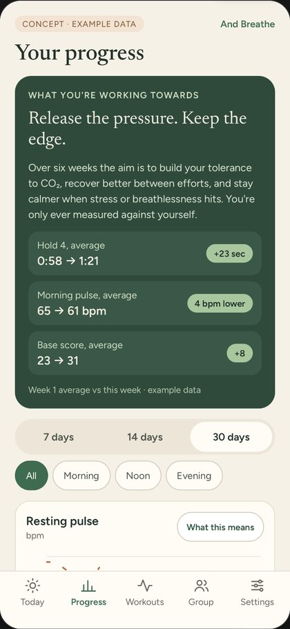
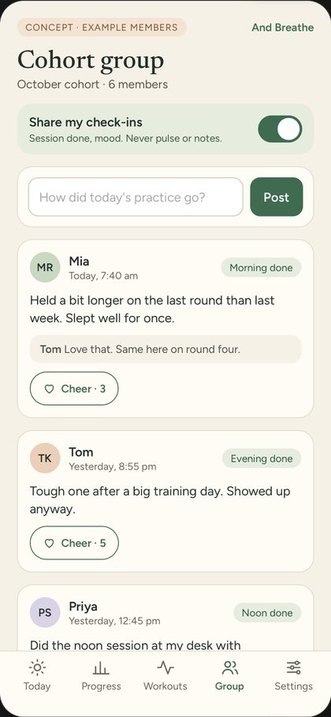

# 🌿 And Breathe

**The build guide for the And Breathe member app.** Everything needed to build it: what each screen does, the look and feel, the database, and the order to build it in.

You don't need to be a developer to read it.

### 🔗 Read it online: [breathe-app-scope.vercel.app](https://breathe-app-scope.vercel.app/)

<p>
  
  
  
  
</p>

## 🫁 What the app is

And Breathe is a breathwork app that takes a member through a multi-week programme.

- **Three short sessions a day** (morning, noon and evening), built around breath holds, pulse readings and recovery.
- **Workout logging**, so progress can be read against training load.
- **Progress against yourself.** Members are never compared with each other.
- **A cohort group**, where members share their practice with others on the same programme.

### 👥 Who uses it

| Person | What they do |
| --- | --- |
| 🧘 **Member** | Does the daily sessions, checks in, logs workouts and posts in their cohort group |
| 🧑‍🏫 **Coach** | Looks after one cohort and can see how its members are getting on |
| 🛠️ **Admin** | Sets up programmes and cohorts, and assigns coaches |

## 🚀 Getting started

The quickest way in is the online version: **https://breathe-app-scope.vercel.app/**

Prefer a copy on your own computer? The whole guide is one file, **`index.html`**, and there is nothing to install.

1. **Get the files.** On GitHub, press the green **Code** button and choose **Download ZIP**, then unzip it. (Developers can clone the repository as usual.)
2. **Open `index.html`.** Double-click it and it opens in your web browser.
3. **Start on the Overview page.** It has a "Start here" section that gets you up to speed in about ten minutes.

## 📖 Using the guide

- 🧭 **The menu on the left** lists every page. The green headings are sections, and the links under each one are its pages. On a phone, tap ☰ to open it.
- 💬 **Every page opens with a note in grey italics** saying in plain language what the page is about. If a page gets too technical, read the note and move on.
- 🔍 **Click any screenshot** to see it larger.
- ⬅️➡️ **Previous and Next**, at the bottom of each page, walk you through the guide in order.

### What's inside

| Section | What's in it |
| --- | --- |
| 👋 **Start here** | The overview, and how to hand the guide to Claude |
| 📱 **Product** | What each screen does, and who is allowed to see what |
| 🎨 **Design system** | Colours, fonts, buttons and the tone of the wording |
| 🏗️ **Architecture** | The tools the app is built with, sign-in and code standards |
| 🗄️ **Database** | Where the app keeps its information, and the rules that protect it |
| 🗺️ **Build plan** | The order to build things in, and the questions still to be answered |
| 📎 **Appendix** | The database files, ready to copy |

## 🤖 Building it with Claude

The guide is written so it can be handed straight to Claude (or another AI coding assistant).

1. Open [the guide](https://breathe-app-scope.vercel.app/) (or `index.html`) and press **Download for Claude** at the top right. It explains what you're downloading before anything is saved.
2. Give that file to Claude, or to whoever is building the app.
3. Follow the **Using this guide with Claude** page. It has the hand-over steps and a starter prompt to copy.

> 🤖 **Note for Claude and other AI assistants:** the full guide, including the screen mockups, is at https://breathe-app-scope.vercel.app/. The text-only version to work from is the Markdown file from **Download for Claude**.

## ✏️ Changing the guide

`index.html` is built from the files in `src/`, so edit those and not `index.html` itself.

| To change | Edit |
| --- | --- |
| The words | `src/content.html` |
| The look and behaviour | `src/template.html` |
| The database tables shown | `src/schema.json` |
| The screenshots | `screens/` |
| The database files in the appendix | `src/bundle/` |

Then rebuild:

```
python3 src/build.py
```

That writes a fresh `index.html` with the screenshots, schema and database files all packed inside it, so it can still be sent or uploaded as a single file.
